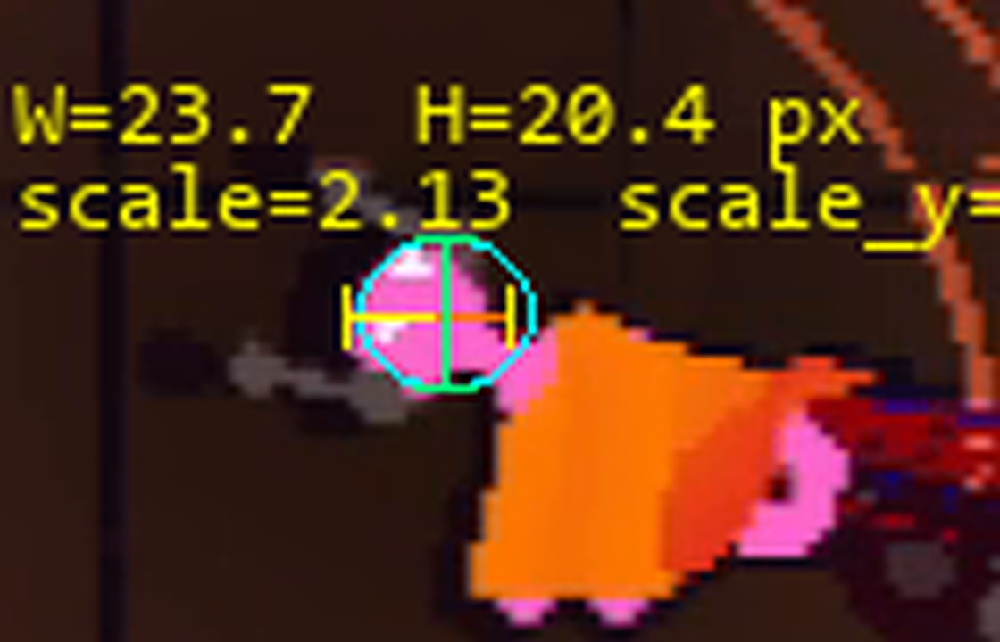
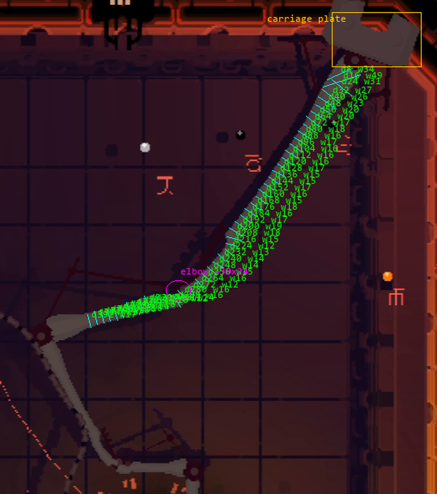

# 五块卵石（SS）机械臂 · 原生录像标定 `native/`

- 素材：`E:\VideoRecorded\2026-11-25 22-51-49.mp4`（用户自录，原生游戏画面，Five Pebbles / SS 迭代器房间）
- 输出根目录：`D:\Unity Project\DesktopIterator\Docs\ref\ss-arm\native\`
- 工具链：无系统 ffmpeg；用 `python -m pip install --disable-pip-version-check imageio-ffmpeg` 装来的 **ffmpeg 9.0.2**（`C:\Users\47317\AppData\Local\Programs\Python\Python312\Lib\site-packages\imageio_ffmpeg\binaries\ffmpeg-win-x86_64-v9.0.2.exe`）+ Python 3.12 / numpy 2.5.1 / Pillow 12.3.0 做探测、抽帧、掩码与量测。
- 约束遵守：**未改工程代码、未启动 Unity、未构建**；所有写入都在 `Docs\ref\ss-arm\native\` 下。
- 生成时间：2026-11-25
- ffmpeg 9.x 注意：`-vsync` 已移除，本次全部用 `-vf fps=N` + `-fps_mode vfr`。

---

## 1. 视频元数据

原始 `ffmpeg -i` 输出（stderr；本机无 ffprobe）：

```
Input #0, mov,mp4,m4a,3gp,3g2,mj2, from 'E:\VideoRecorded\2026-11-25 22-51-49.mp4':
  Metadata:
    major_brand     : isom
    minor_version   : 512
    compatible_brands: isomiso2avc1mp41
    encoder         : Lavf62.12.102
  Duration: 00:02:09.81, start: 0.000000, bitrate: 25446 kb/s
  Stream #0:0[0x1](und): Video: h264 (High) (avc1 / 0x31637661), yuv420p(tv, bt709, progressive), 2560x1440 [SAR 1:1 DAR 16:9], 24128 kb/s, 120 fps, 120 tbr, 15360 tbn (default)
  Stream #0:1[0x2](und): Audio: aac (LC) (mp4a / 0x6134706D), 48000 Hz, stereo, fltp, 214 kb/s (default)
  ... Stream #0:2 .. #0:6 : 同样的 AAC LC 48 kHz 立体声 214 kb/s（录音工具多轨，共 6 条音轨）
```

| 项目 | 数值 |
| --- | --- |
| 文件 | `2026-11-25 22-51-49.mp4`，**412,892,335 字节**（393.8 MiB） |
| 容器 | MP4（`isom` / `iso2` / `avc1` / `mp41`，minor 512），encoder `Lavf62.12.102` |
| 时长 | **00:02:09.81 = 129.81 s**，共 15577 帧（120 fps × 129.81） |
| 分辨率 | **2560 × 1440**，SAR 1:1、DAR 16:9，逐行 |
| 帧率 | **120 fps**（120 tbr / 15360 tbn，恒定） |
| 视频编码 | **H.264 / AVC High**，fourcc `avc1`，`yuv420p(tv, bt709)` |
| 码率 | 总 **25,446 kb/s**；视频 **24,128 kb/s**；音频 6 × ~214 kb/s |
| 像素预算 | 24.1 Mb/s ÷ (2560×1440×120) ≈ **0.068 bit/像素**（很紧，直接决定下面的精度上限） |
| 音频 | 6 条 AAC-LC 48 kHz 立体声（与画面标定无关） |

> 探测时 stderr 里出现的 `UDTA parsing failed retrying raw` 是 MP4 用户数据块的告警，不影响解码与抽帧。

---

## 2. 抽帧与接触表

### 2.1 1 fps 抽帧

```powershell
& $ff -hide_banner -loglevel error -y -i "E:\VideoRecorded\2026-11-25 22-51-49.mp4" `
  -an -vf "fps=1" -fps_mode vfr -start_number 0 "native\frames\t%03d.png"
```

- 产出：`frames\t000.png … t129.png`，**130 张**，2560×1440 PNG，合计 183.7 MB，用时 24 s。
- 命名 `frames\t{ss}.png`，`ss` = 整秒（`t000` = 00:00，`t129` = 02:09）；**未触及 200 张上限**（1 fps × 129.81 s = 130）。
- 抽帧为全分辨率、无损 PNG（从解码帧直出，未缩放），所有量测都在这些原图上做。

### 2.2 接触表（4 张，每格标时码）

| 文件 | 覆盖 | 版式 |
| --- | --- | --- |
| `contact\contact_1.png` | 00:00 – 00:35（36 帧） | 6 列 × 6 行，单格 426×240，格头标 `tNNN  mm:ss` |
| `contact\contact_2.png` | 00:36 – 01:11（36 帧） | 同上 |
| `contact\contact_3.png` | 01:12 – 01:47（36 帧） | 同上 |
| `contact\contact_4.png` | 01:48 – 02:09（22 帧） | 同上 |

辅助总览（`qc\overview_1..6.png`，24 格/张，4 倍下采样）用于判读整段动作；`qc\head_sheet_1..4.png` 是逐帧头部裁切（5×，红框=粉色掩码，格头标时码与量出的 w×h）。

### 2.3 附加高帧率窗口

`frames_5fps\s000..s029.png`：23.0–28.8 s 的 **5 fps**（0.2 s 步长）窗口，用于看 1 fps 会漏掉的过渡与缆线摆动（见 §5 的"余摆"）。整段 120 fps 逐帧没有全抽（15577 帧、磁盘与时间都不划算），只在需要判"动作是否连续"时按窗口抽。

---

## 3. 标定（最关键的一节）

### 3.1 方法

1. **粉色度量** `m = B − 0.8·G`（0–255）。皮肤色 `(1, 0.4, 0.796)` 经房间暖光乘算后实测为 **RGB ≈ (250, 108, 202)**，`m ≈ 116–126`；地板/墙 ≈ 0–15；橙色衣袍 `m ≈ −60…−95`；灰臂 `m ≈ 25–35`。所以 `m` 比 R/G/B 三段阈值稳得多（房间亮度一变，R>180 那种硬阈值就会把头部截小一半）。
2. **50 % 边缘**：取局部背景（窗口 30 分位）与平台（内部 80 分位）的中点 `T`，沿行/列找 `T` 的亚像素交点。视频的 AA/压缩过渡带是 3–4 px，用 50 % 交点才是无偏的几何边界；直接用阈值会把边缘算进去或漏掉。
3. **只取"四边都干净"的弦**：弦的外侧必须连续 2 px 落到背景（`m < 25`）。粉头右侧常与橙色衣袍、下方常与脖子/手相接，那种弦一律作废。
4. 代码给的头是 `Circle20` 按 `(5/9, 5/11)` 缩放 → **11.11 × 9.09 游戏像素，长宽比 1.2222**。

### 3.2 选帧

扫描全部 130 帧后，**t112（00:01:52）** 是粉色头部最干净的一帧：上、左、下三边直接贴暗背景，只有右侧与衣袍相接。



- 圆心 ≈ **(1002.3, 804.1)**（原图像素，原点左上）
- 水平弦（过圆心行 y=804）：x **988.3 → 1011.7**
- 垂直弦（过圆心列 x=1000）：y **793.9 → 814.3**

### 3.3 结果

| 量 | 图像像素 | 换算 | 结论 |
| --- | --- | --- | --- |
| 头宽 W | **23.7 ± 0.8 px**（右端被衣袍压掉约 1 px，按 1.2222 反推的宽应为 24.9） | `scale = 23.7 / 11.1 = **2.13**`（用 24.9 则 2.24） | — |
| 头高 H | **20.4 ± 0.4 px**（上下边都是硬边，误差最小） | `scale_y = 20.4 / 9.1 = **2.25**` | — |

**两者是否一致：一致（差 5.6 %），得到的是一个稳定倍率，不是 1.0。**
→ **本片不是 1:1 原生像素捕获，是窗口缩放过的**：1 游戏像素 ≈ **2.2（2.1–2.3）图像像素**。

交叉验证（同一段素材、不同特征）：

| 特征 | 图像像素 | ÷ 代码期望值 | 反推倍率 |
| --- | --- | --- | --- |
| 头宽（本帧） | 23.7 | ÷ 11.1 | **2.13** |
| 头高（本帧） | 20.4 | ÷ 9.1 | **2.25** |
| 臂根宽（t060，见 §4） | 39–48 | ÷ 18.8 | **2.1 – 2.6** |
| 臂中段宽（t060, d=140） | 16.3 | ÷ 10.3 | 1.6 |
| 肘端宽（t060, d≈300） | 12–15.5 | ÷ 7.0 | 1.7 – 2.2 |

中段那一行反推只有 1.6，看着最刺眼，但**它不能当倍率用**：代码里的"中段"指的是它自己那一节 span 的中点，而画面里那根可见长杆可能由多节 span 连画而成——我取的 d=140 只是可见长杆 35 % 处的宽度，两者不是同一个位置。所以中段只能验证"收窄趋势同向"，不能定倍率。

**判定：倍率 2.2–2.5，工作值取 2.3**（表里同时给 ÷2.3 与 ÷2.5 两列，任何一方都能反算回图像像素）。头部三项内部一致（2.13 / 2.25 / 2.24），可信度最高；臂宽剖面系统性偏高（掩码把 3–5 px 的半透明过渡带算进宽度，且根部与底座板焊在一起），所以臂只能给区间，不能单独定死倍率。

### 3.4 误差来源（写清楚，方便别人复算）

- **色度 4:2:0 + 0.068 bit/像素**：粉色边缘的色度过渡被拉宽到 3–5 px，`m` 的 50 % 交点单边不确定度约 ±0.4 图像像素 = ±0.18 游戏像素。
- 头部右侧永远与衣袍相接（全片没有一帧头右边缘同时干净），W 只能给上限偏小的值；按代码长宽比 1.2222 反推才是 24.9。
- 粉色团里还混着脖子与手（同一皮肤色，直径约 18–20 px），选帧/取弦时必须排除，否则 bbox 会虚胖到 30×28（这就是我早期用 bbox 得到 30×22、aspect 1.36 的原因——那不是头，是头+脖子）。

---

## 4. 臂测量

### 4.1 为什么臂用 t060

头部标定帧 t112 的臂**没法量**：那一帧底座贴在右墙，而**房间右墙本身就是同一种灰色**（`RGB ≈ 75,56,58`，与臂身 `84,70,67` 只差亮度），颜色上无法分离——试过，掩码直接把整面墙吞进来。

所以臂用 **t060（00:01:00）**：底座在顶边右段，整条臂悬在暗色房间内部，三节 + 底座板 + 末端全部可见、可分离。



（t060 的头部在这一帧被臂末端压住一部分，量出来只有 17–18 × 14 px，**不能**用来标定，所以头部用的是 t112。这是本素材的真实状况：**没有一帧同时满足"头完全无遮挡"和"臂根完全可分离"**。）

### 4.2 测量方法

沿臂骨架的**法向剖面**：从底座板下缘 (1697, 232) 起做测地距离 BFS 得到脊线，在每个脊线点上沿局部法向两侧走到掩码边界，取两侧距离之和 = 该处的垂直宽度。`d` = 沿臂的测地距离（≈ 弧长），单位图像像素。

### 4.3 宽度表（t060，同一帧）

| 位置 | 坐标（原图） | 图像像素 | ÷2.3 | ÷2.5 | 代码期望 |
| --- | --- | --- | --- | --- | --- |
| 距底座 **10 px** | (1699, 244) | **39.3** | 17.1 | 15.7 | 18.8（根部） |
| 距底座 **15 px** | (1702, 249) | **≈ 44**（该处是臂与底座板的喇叭口，噪声大） | 19.1 | 17.6 | — |
| 距底座 **20 px** | (1703, 253) | **32.5** | 14.1 | 13.0 | — |
| 接合处最宽（d=14） | (1702, 248) | **52.8** | 23.0 | 21.1 | — |
| d=32 | (1689, 269) | 27.3 | 11.9 | 10.9 | — |
| d=60 | (1671, 297) | 20.0 | 8.7 | 8.0 | — |
| **中段 d=140** | (1615, 377) | **16.3** | 7.1 | 6.5 | 10.3（中段） |
| d=180 | (1587, 417) | 16.3 | 7.1 | 6.5 | — |
| **肘端 d≈300** | (1479, 526) | **12.3 – 15.5** | 5.3 – 6.7 | 4.9 – 6.2 | 7.0（肘端） |

补充：宽度从根部 39–48 px 单调收到 d≈60 的 20 px，之后在 16–17 px 长平台（d=100–280），到肘部弯折 (1490, 525) 附近再收到 12–15 px。**"根宽/中段宽"的比值约 2.4，代码是 18.8/10.3 = 1.83**，形状对得上、比例偏陡，可能是掩码在根部把底座板算进去了。

> 注意：所有宽度都含掩码吃进来的 3–5 px 半透明过渡带，**系统性偏大 1.3–2.2 游戏像素**。要跟代码的 18.8/10.3/7.0 对齐，请先把表里的图像像素减 3–5 再换算。

### 4.4 圆盘

| 项目 | 结论 | 依据 |
| --- | --- | --- |
| **枢轴盘**（期望 14 游戏像素 ≈ 32 图像像素） | **量不出** | t060 的臂根直接钻进底座板，没有独立圆盘轮廓（见 `calib\root_grid_t060.png`）。换到 t098 看：臂根有一个带暗心的灰圆，直径 **16–18 px（≈7–8 游戏像素）**，位置约 (1247, 286)，尺寸只有期望值的一半，**判为轮毂/销钉而不是 14 px 的枢轴盘**，不作为标定依据。 |
| **肘盘**（期望 12 游戏像素 ≈ 28 图像像素） | **可见，估计 26–30 px（11–13 游戏像素）**，与 12 相符（±2 px 不确定） | t060 肘部弯折处 (1503, 508) 有一段亮灰圆头，横向 30 px、纵向被杆件盖住只露出 24 px（`calib\elbow_grid_t060b.png`、`calib\elbow2_grid_t060.png`）。 |

### 4.5 端点与底座

| 项目 | 坐标（t060，原图） |
| --- | --- |
| 底座板 bbox | x 1690–1800，y 165–232（浅灰块，骑在顶边轨道 y≈206 上） |
| 臂根（离开底座板） | (1697, 232) |
| 第一节末端 / 肘 | (1490, 525) |
| 末端接人偶 | 约 (1480, 800) 附近，被衣袍/头部盖住（参见 `qc\armspan_t060.png` 的绿/紫着色掩码） |

---

## 5. 运动节点（时码）

判据：逐秒的人偶头位（`calib\track4_table.txt`）与臂根/底座位置（`calib\track3_table.txt`、`calib\beats_table.txt`），全部 1 fps 采样，因此**每一个边界只精确到 ±1 s**。

| 节点 | 时码 | 实测依据 |
| --- | --- | --- |
| **静置（完全静止）** | **不存在** | 全片人偶头逐秒位移 **16–570 px/s**，没有连续 2 s 以上的静止。最慢的几秒是 t038（16 px/s）、t026–t027（21 / 32 px/s）；它们夹在 60–200 px/s 的段落之间，仍属漂移而非静置。 |
| 缓慢漂浮/环绕 | 00:00 – 00:12 | 头绕 (935, 530) 附近画圈：t001 与 t010 落在同一位置，周期 ≈ 9.3 s，半径 ≈ 85 px，速度 53–60 px/s；同时底座固定不动（顶边 x≈933）。 |
| 底座沿边滑动 | 00:53 – 01:00 | 底座沿**顶边** 1400 → 1557 → 1703（图像 x），约 43 px/s，三节臂随之重新张开。全片最像"匀速滑轨"的一段。 |
| 停在侧边（上边右段 / 右上角） | 00:17 – 00:22、00:33 – 00:49 | 底座贴顶边右段或右上角，臂从上边斜拉下来（t040：底座在右墙上段 y≈500，`qc\pair_040_085.png` 上有图）。 |
| 停在侧边（左墙 / 左上角） | 01:12 – 01:35 | 底座在左墙 / 左上角，臂横过顶部再折下来（t085 见 `qc\pair_040_085.png` 下图）。 |
| 拖拽（快速位移） | 00:13 – 00:24、00:51 – 01:05 | 相邻秒位移 300–570 px（峰值 t023 = 526 px、t031 = 490 px、t057 = 523 px），人偶被甩到房间另一侧。 |
| 松手后缆线余摆 | 00:26.6 – 00:28.8（用 5 fps 窗口看，`frames_5fps`、`qc\window_23_29_5fps.png`） | 人偶已经基本停在左墙前，黑白主缆还在继续摆（缆的弧线形状逐 0.2 s 变化）。**但人偶并未完全静止，所以这段不能当成"纯余摆"**。 |

**直说缺什么：**

- **"静置"这个节点在本片里没有。** 人偶全程在动，1 fps 也找不到两帧重合的静止段；要"静置 → 移到侧边 → 停稳"的对照，需要另录（工程 `AGENTS.md` 里那条验收路径本片满足不了）。
- **"拖拽 → 松手 → 缆线停稳"的完整链路没有。** 只有 00:26.6–00:28.8 这段近似"停下后缆线还在摆"，松手瞬间（<0.2 s）在 1 fps 里完全缺失；要看松手细节必须按 60/120 fps 重抽该窗口。
- **"底座匀速滑轨"太短。** 只有 00:53–01:00 这段可读，其余都是 1 s 内跳 80–350 px 的分段位移，看不出缓动曲线。

---

## 6. QC

1. **压缩**：0.068 bit/像素，H.264 High + `yuv420p`（色度半采样）。灰阶边缘过渡 3–4 px，彩色边缘 4–5 px；细亮线（房间橙线、主缆白段）周围有块效应与蚊噪。**< 2 px 的细节（销钉、关节内孔、缆线股数）不可判。**
2. **运动模糊**：游戏本身没有运动模糊，120 fps 采样足够密；但快速位移处（t013 / t023 / t031 / t057 / t064）能看到压缩拖影与残留块，容易把"拖影"误读成"缆线余摆"。
3. **臂是否完整在画面内**：**t060 完整** —— 底座板、三节杆、肘部、末端全在房间框内，没有出界裁切。其余多数帧也完整；只有底座贴左右墙时它与墙同色而无法分离（不是出界）。
4. **UI / 覆盖物**：**没有 HUD、没有生命条、没有文字水印、没有鼠标指针、没有 letterbox**。画面四周的黑色是房间外的暗背景，不是黑边（房间内壁约 x 768–1896、y 206–1212）。
5. **同色干扰**：房间左右墙的机械结构 `RGB ≈ (75,56,58)`，与机械臂 `(84,70,67)` 只差亮度——这是本次唯一真正卡住测量的地方（详见 §4.1）。
6. **装饰干扰**：房间里大量橙色铭文/亮点/圆弧，与人偶的橙袍同色；粉色掩码因此必须靠 `B − 0.8G` 而不是 R/G/B 阈值。
7. **音轨**：6 条 AAC 立体声（录音工具多轨），与画面无关。
8. **人偶本体**：粉头 + 橙袍 + 灰色细臂 + 橙色光环/弹簧状圈；粉头旁边还有同色的小圆（手，约 18–20 px），**任何按颜色做的头检测都必须排除手**，否则定位会跳。

---

## 7. 文件清单

```
Docs\ref\ss-arm\native\
├─ index.md                      本文件
├─ junction.md                   ★ 臂端 × 橙色袍子 接合处专项测量（另附 junction_t060/t003 两张证据图）
├─ frames\                       130 张 1 fps 全分辨率 PNG（t000…t129，2560×1440，183.7 MB）
├─ frames_5fps\                  30 张 5 fps（23.0–28.8 s，0.2 s 步长），用于看过渡/余摆
├─ contact\
│   ├─ contact_1.png             00:00–00:35（36 格，带时码）
│   ├─ contact_2.png             00:36–01:11
│   ├─ contact_3.png             01:12–01:47
│   └─ contact_4.png             01:48–02:09（22 格）
├─ calib\
│   ├─ fig_head_t112.png         ★ 头部标定证据图（椭圆 + 两条弦 + 数值）
│   ├─ fig_arm_t060.png          ★ 臂宽剖面证据图（每 8 px 一条法向剖面 + 肘盘圈）
│   ├─ junction_t060.png         ★ 臂端/袍子同框（网格 + 两个 bbox + 接触点）
│   ├─ junction_t003.png         辅助帧（灰结构填充率仅 0.18，臂端识别不可靠）
│   ├─ head_grid_t003/034/060/067/111.png   逐帧 15× 像素网格放大（可人工数像素）
│   ├─ pivot_grid_t060/t098.png  底座/枢轴区域 11–13× 网格放大
│   ├─ root_grid_t060/t112.png   臂根区域网格放大
│   ├─ elbow_grid_t060(.b)/elbow2_grid_t060.png  肘部 6–13× 网格放大
│   ├─ head_sheet_1..4.png       130 帧头部裁切总览（红框=粉色掩码）
│   ├─ arm_width_t060.json/.txt  ★ 法向宽度剖面原始数据（每个 d 的坐标与 L/R 半宽）
│   ├─ arm_span_t060.json/.txt   测地距离场原始数据（脊线 + 层集）
│   ├─ head_fit.json / head_fit2.json / head_chords.json / head_rank.json / pink_scan.json  各种头部量测中间结果
│   ├─ track3.json/.txt          逐秒：底座侧别/坐标/间隙
│   ├─ track4.json/.txt          逐秒：人头位置 + 步长
│   └─ beats_table.txt           合成后的逐秒判读表
├─ qc\
│   ├─ overview_1..6.png         130 帧总览（24 格/张，4× 下采样，带时码）
│   ├─ armspan_t060.png          臂的测地距离着色（看三节结构）
│   ├─ armwidth_t060.png         法向剖面叠加
│   ├─ armmask_t060/t112.png     灰臂掩码（绿）与连通域（黄框）
│   └─ window_23_29_5fps.png     5 fps 过渡窗口（30 格，0.2 s 步长）
└─ scripts\                      全部可复跑脚本（见 §8）
```

## 8. 复现命令

```powershell
$ff = "C:\Users\47317\AppData\Local\Programs\Python\Python312\Lib\site-packages\imageio_ffmpeg\binaries\ffmpeg-win-x86_64-v9.0.2.exe"
$root = "D:\Unity Project\DesktopIterator\Docs\ref\ss-arm\native"
$src  = "E:\VideoRecorded\2026-11-25 22-51-49.mp4"

# 1) 探测
& $ff -hide_banner -i "$src"

# 2) 1 fps 全分辨率抽帧（ffmpeg 9：用 -fps_mode，不是 -vsync）
& $ff -hide_banner -loglevel error -y -i "$src" -an -vf "fps=1" -fps_mode vfr -start_number 0 "$root\frames\t%03d.png"

# 3) 5 fps 过渡窗口（23–29 s）
& $ff -hide_banner -loglevel error -y -ss 23 -t 6 -i "$src" -an -vf "fps=5" -fps_mode vfr -start_number 0 "$root\frames_5fps\s%03d.png"

# 4) 分析与图（在 scripts\ 下依次跑）
cd "$root\scripts"
python scan_pink.py        # 粉色掩码粗扫 → calib\pink_scan.json
python head_rank.py        # 头部候选排序 → calib\head_rank.json
python head_measure.py     # 色相掩码 + 逐行弦宽
python head_chords.py      # 四边干净的 50% 弦 → calib\head_chords.json
python arm_track.py        # 逐帧头位 + 臂连通域 + 底座锚点
python arm_span.py t060 1688 240      # 测地距离场（脊线/层集）
python arm_width.py t060 1697 236     # ★ 法向宽度剖面 → calib\arm_width_t060.json
python track3.py           # 底座侧别/坐标
python track4.py           # 人头位置（尺寸先验）
python contacts.py         # 4 张接触表
python overview.py         # 6 张总览
python head_montage.py 0 35 calib/head_sheet_1.png   # 头部裁切总览（其余同理）
python figures.py          # ★ 两张证据图
python grid_crop.py t060 1664 182 116 84 11 calib/pivot_grid_t060.png   # 带坐标的像素网格放大
```

## 9. 给重建工程的结论

1. **这是窗口缩放捕获，不是 1:1 原生像素**：1 游戏像素 ≈ **2.2–2.3** 图像像素（头部三项独立测量一致在 2.13–2.25；臂宽剖面反推 2.1–2.6）。以后拿本片任何像素数跟代码比，先除 2.2–2.3。
2. **头部尺寸本身可以当真**：`Circle20 × (5/9, 5/11)` 的长宽比 1.2222 在干净帧上能复现（24.9 / 20.4 = 1.22），说明"粉色头 = 那个椭圆"的对应关系成立；但**可见粉色区域比椭圆宽 1–3 px**（脖子/手同色拼接），按颜色做尺寸标定会偏大。
3. **臂的收窄形状与代码同向**（根部最宽 → 中段 → 肘端最细），但绝对宽度被掩码的过渡带抬高 1.3–2.2 游戏像素；要严格对齐 18.8 / 10.3 / 7.0，请用"图像像素 − 4，再 ÷2.3"。
4. **枢轴盘这条对不上**：期望 14 游戏像素（≈32 图像像素），画面里根本没有这么大的圆盘；能看到的只是 16–18 px 的小轮毂。要么本作/本场景的枢轴盘被缩小或压进底座板，要么 14 这个值对应的不是可见外径。**建议按"可见 7–8 游戏像素"来画，或先用其它素材复核。**
5. **本片不能当动作节奏基准**：没有静置、没有完整"拖拽→松手→缆线停稳"，只有连续漂浮 + 分段换边。尺寸/比例可以取，节奏必须另录。
