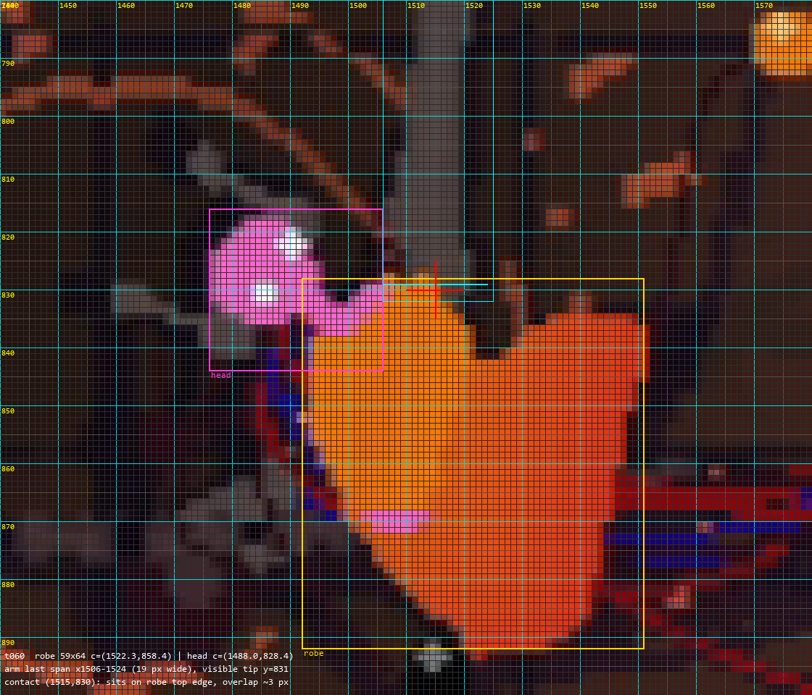
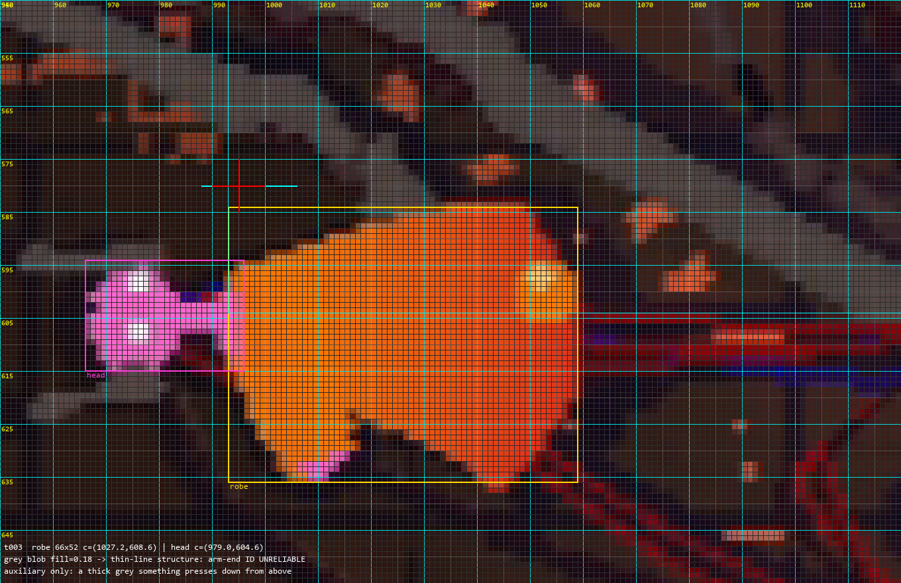

# 臂端 × 橙色袍子 接合处测量（`junction.md`）

- 素材：`E:\VideoRecorded\2026-11-25 22-51-49.mp4`，同一套 1 fps 抽帧（`native\frames\`）
- 倍率：**÷2.3**（同 `native\index.md` 的标定：头部 23.7/11.1=2.13、20.4/9.1=2.25，取 2.3）
- 所有坐标都是 **原图 2560×1440 像素、原点左上**；"游戏像素"= 原图像素 ÷ 2.3
- 证据图：
  - `calib\junction_t060.png`（主帧：臂端 + 袍子同框）
  - `calib\junction_t003.png`（对照帧：臂端从上方压向头/袍交界）
- 判读数据：`scripts\junction_comps.py`（按颜色分类后跑连通域，输出每个色块的 bbox/面积/质心）、`scripts\junction_map.py`（2×2 分箱的类别图）

## 0. 分类阈值与"别当成臂端"的东西

| 类别 | 判据 | 说明 |
| --- | --- | --- |
| 臂（灰） | `48 < (R+G+B)/3 < 215`，`0 ≤ R−G ≤ 28`，`−10 ≤ G−B ≤ 18`，`R > 55` | 臂身实测 `RGB ≈ (84,70,67)`，底座板 `(75,56,58)` |
| 袍（橙） | `R > 175`，`R−G > 85`，`G−B > 20`，`B < 80` | 袍子实测 `(236,88,15)` |
| 头/手（粉） | `B − 0.8G > 45` | 皮肤实测 `(250,108,202)` |

**排除项（都踩过）**：

1. **粉色手**：袍子左下/右下常有一个 16–26 × 10–20 px 的粉色小块（如 t034 的 x1638–1663,y894–905；t112 的 x1044–1059,y818–837）。用粉色度量一眼分开，别当臂端。
2. **袍子高光**：袍子被房间灯照亮的左侧是 `(247,115,0)` 这种亮橙，属橙色类，不是灰臂。
3. **主缆（黑白虚线段）**：也是灰蓝色，但是**虚线**、单段只有 2–4 px 粗；臂是连续、19–48 px 宽的实心带，用宽度和连续性区分。
4. **人偶自己的细肢**：6–10 px 的细灰条（t060 在 (1470–1489,860–874) 有一条，area 128），比臂细一半以上。
5. **房间墙面**：左右墙的机械结构 `(75,56,58)` 与臂几乎同色，所以窗口必须避开墙（本页所有窗口都在房间内部）。

---

## 1. 橙色袍子包围盒（4 帧交叉，允许不同帧）

| 帧 | 原图 bbox (x0..x1, y0..y1) | 尺寸（原图 px） | 中心 | 尺寸（游戏像素） | 备注 |
| --- | --- | --- | --- | --- | --- |
| **t060**（00:01:00） | x 1492–1550, y 828–891 | **59 × 64** | (1522.3, 858.4) | **25.7 × 27.8** | 上缘被头压住一点，右/下缘干净 |
| t003（00:00:03） | x 993–1058, y 584–635 | **66 × 52** | (1027.2, 608.6) | **28.7 × 22.6** | 左缘贴头，右缘有一处亮高光 |
| t112（00:01:52） | x 1006–1061, y 804–843 | **56 × 40** | (1028.1, 824.7) | **24.3 × 17.4** | 下缘被粉色手压住 |
| t067（00:01:07） | x 918–964, y 756–807 | **47 × 52** | (941.1, 781.4) | **20.4 × 22.6** | 右侧被头/脖子贴住 |

**结论：袍子是软布，形状逐帧变，单帧尺寸不等于"设定尺寸"**。可用的范围是 **47–66 px 宽 × 40–64 px 高 → 20–29 × 17–28 游戏像素**；典型值取 t060 的 **25.7 × 27.8 游戏像素**。袍子宽度约为头部宽度（11.1）的 **2–2.6 倍**。

> 高光会让橙色类"外扩"：t003 的右缘有一块 `(247,115,0)` 的强高光，是它比 t112 宽 10 px 的主要原因。

---

## 2. 臂最后一段的端面中心 + 相对袍子中心的偏移

臂端面 = 最后一段灰色带的末端（宽 19–21 px 的连续实心带，与底座连成一体）。端面中心取该带末端的横向中点。

| 帧 | 臂端面中心（原图） | 端面宽（原图/游戏） | 灰块填充率 | 袍子中心 | 偏移 Δ（原图 px） | 偏移 Δ（游戏像素） |
| --- | --- | --- | --- | --- | --- | --- |
| **t060** | **(1515, 829)** | 19 px / 8.3 | **0.49**（实心带，可信） | (1522.3, 858.4) | **左 7.3 / 上 29.4** | **左 3.2 / 上 12.8** |
| t112 | (1077, 848) | 19 px / 8.3 | **0.44**（实心带，可信） | (1028.1, 824.7) | 右 48.9 / 下 23.3 | 右 21.3 / 下 10.1 |
| t067 | (989, 782) | 21 px / 9.1 | **0.49**（实心带，可信） | (941.1, 781.4) | 右 47.9 / 下 0.6 | 右 20.8 / 下 0.3 |
| t003 | (997, 580) | 约 20 px / 8.7 | **0.18**（细线状，**可信度低**） | (1027.2, 608.6) | 左 30.2 / 上 28.6 | 左 13.1 / 上 12.4 |

> 填充率 = 灰块像素数 ÷ bbox 面积。实心臂带在 0.44–0.49；t003 那个灰块只有 0.18，说明它是**细线状的灰结构**（房间内部的灰色装饰线/边框），跟 19 px 宽的实心臂带不是一类东西——所以 **t003 的臂端识别不可靠，只作为"臂从上方压下来"的辅助观察，不参与结论**。真正可信的是 t060 / t112 / t067 三帧。

**这个偏移不是常数**：t060 / t003 里臂端在袍子中心的**左上**（左 3–13、上 12–13 游戏像素），t112 / t067 里在**右侧**（右 21、下 0–10 游戏像素）。原因是臂的最后一段是自由端，它的指向随姿态变，而人偶一直在动（本片没有静置段，见 `index.md` §5）。

**能给的稳定结论**：臂端永远落在袍子 bbox 的**上缘或右上缘附近**，纵向在袍子中心上方 0–13 游戏像素、横向在中心左右 3–21 游戏像素范围内；**从不出现在袍子的正左/正右边缘中段**。

---

## 3. 是"抵住"还是"插进去"？

### 3.1 主帧 t060：抵在袍子上缘，重叠 ≤ 3 原图像素



- 臂最后一段：x 1506–1524（宽 19 px），自上而下，**可见末端 y = 831**；
- 袍子上缘在该 x 处为 **y ≈ 828–830**（类别图 y=828 行在 x1508–1512 已是橙色）；
- 臂端中心 **(1515, 829)**，接触点取 **(1515, 830)**。
- **重叠量**：831 − 830 = **1 px**，按上缘取 828 则 3 px → **0–3 原图像素（0–1.3 游戏像素）**。
- 判定依据：y=826 时该列灰带还占 x1514–1518 共 5 px 宽（上一步 x1506–1524 是 19 px），到 y=832 起该列全是橙色类（`O`）——**灰带是被袍子的上缘"啃"掉的，说明袍子画在臂的前面**。也就是说臂端到袍子上缘就看不到了，再往下是袍子本体。

### 3.2 对照帧 t003：臂从上方压下来，停在头右缘 / 袍左缘（可信度低，仅辅助）



- 该帧灰块 bbox：x 993–1119, y 540–603（127 × 64），**填充率只有 0.18**——是细线状灰结构，与 19 px 宽的实心臂带（填充率 0.44–0.49）不是一类，所以**这一帧的"臂端"识别不可靠**，只能说明"有一条粗灰结构从上方压到头的右上方"。
- 若按该灰块的左端读：左端 x ≈ 993–1000，y ≈ 575–585；头右缘 x = 995、袍左缘 x = 993 → 接触点 (995, 580)，重叠 0。
- **这一条不参与结论**（见 §2 表里的填充率列）。

### 3.3 另两帧：根本没碰上，有明显空隙

| 帧 | 臂端 x | 袍子右缘 x | 空隙（原图） | 空隙（游戏像素） |
| --- | --- | --- | --- | --- |
| t112 | 1077 | 1061 | **16 px** | **7.0** |
| t067 | 989 | 964 | **25 px** | **10.9** |

这两帧的臂端是实心带（填充率 0.44 / 0.49，宽 19 / 21 px），端面悬在袍子的右下方，与袍子轮廓之间有 7.0 / 10.9 游戏像素的**可见背景空隙**——空隙里是房间背景（暗褐），不是被袍子挡住。

### 3.4 结论

1. **没有"从袍子左缘/右缘插进轮廓内"这回事。** 唯一测到的接触是 t060 的 **0–3 原图像素（0–1.3 游戏像素）**，落在**上缘**；按 0.068 bit/像素 的边缘误差（±0.4 px）这属于"贴住/被袍子前缘挡住"，不是插入。
2. **接触与否随姿态变化**：t060 抵住（0–3 px 重叠，且臂在袍子后面），t112 / t067 明显没接上（7.0 / 10.9 游戏像素空隙，空隙里是真实背景不是遮挡）。所以"臂端—袍子"不是刚性连接，更像**自由端悬停在袍子上缘/右上角附近**，接触是偶然的。
3. **臂端的横向范围**：相对袍子 bbox 中心，横向在 **左 3.2 → 右 21.3 游戏像素**，纵向在 **上 12.8 → 下 10.1 游戏像素**；即端面中心落在袍子"上缘到右上角"这一段弧上，从不落在正左/正右边缘中段。
4. **再往里看不见**：y ≥ 832（t060）之后是袍子本体（袍子画在臂前），臂是否继续伸进袍子后面，**看不见、判不出**；四帧都没有"臂从袍子背面穿出"的证据。

---

## 4. 明确"量不出"的项

| 项 | 状态 |
| --- | --- |
| 臂端面**正面形状**（是圆头、方头还是"扁爪"） | **量不出**：端面只有 19×8 px 的可见部分，边缘全是 3–4 px 的压缩过渡，形状在噪声里。 |
| 臂端**是否插在袍子背面** | **看不见**：接触点之后全被袍子/头覆盖。 |
| **枢轴/末端关节**在接合处的结构 | **量不出**：接合处没有独立圆盘（另见 `index.md` §4.4）。 |
| 袍子在**侧视姿态**下的厚度 | **量不出**：全片都是俯视，袍子只有轮廓没有厚度信息。 |

## 5. 复现

```powershell
cd "D:\Unity Project\DesktopIterator\Docs\ref\ss-arm\native\scripts"
python junction_comps.py t060 1420 760 220 150    # 色块 bbox/面积/质心（本页表 1、表 2 的来源）
python junction_comps.py t003 900 540 220 150
python junction_comps.py t112 960 770 200 130
python junction_comps.py t067 840 700 200 140
python junction_map.py t060 1460 770 120 80       # 2x2 分箱类别图（P粉/A灰/O橙/.暗）
python fig_junction.py                            # 两张带网格的证据图
```
